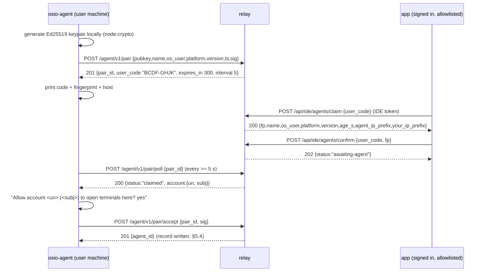
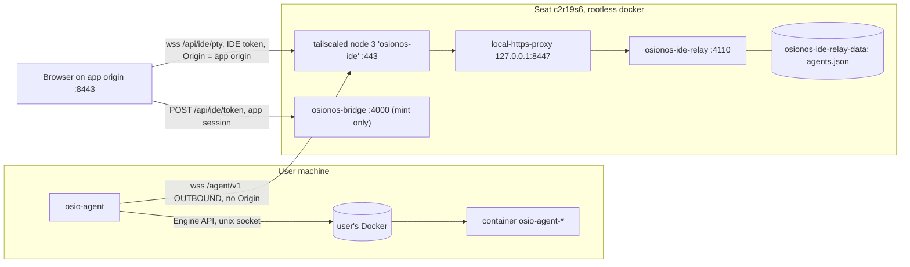

# Contract: bring-your-own-compute terminals (`osio-agent` + `osionos-ide-relay`)

- Status: proposed, for the `devil`'s ruling. No code exists.
- Date: 2026-10-19. Author: architect.
- Scope: phase 1 is a pty only, for the operator and then at most 5 named subjects. LSP, DAP and fsync are phase 1b. Jobs are phase 2 and appear only as §13.
- ADR to hold it: `docs/adr/0023-bring-your-own-compute-terminals-over-an-outbound-agent-relay.md` (groot).
  - The three-gate rule fires: a new public ingress and wire protocol, a binary published to users, and a change to N1.
  - ADR 0021 is absent from every worktree (U10), so 0023 is the next free number.

Tree tags used in every citation:

| Tag | Tree | Commit |
|---|---|---|
| **P** | `/goinfre/dlesieur/groot` (branch `hotfix`), osionos pin | 14014d1e; pin ab21ebd7 (`.git/modules/apps/osionos/app/HEAD`) |
| **W** | `/goinfre/dlesieur/wt-groot-idevm/apps/osionos/app` (osionos develop) | f0e6518e |
| **A** | `/goinfre/dlesieur/wt-groot-allowlist` (branch `fix/ide-allowlist-plane`) | 25a98522 (pushed to origin/main, then superseded by fe81aab8; `.git/logs/refs/remotes/origin/main:17-18`) |
| **G** | `/goinfre/dlesieur/groot/apps/grobase` | as checked out in P |
| **D** | scratchpad `devil-verdict-ide-same-vm.md` | ruling of 2026-10-18 |
| **M** | user memory files (measured in earlier sessions) | dates given inline |

---

## 0. Facts this rests on, and corrections to the brief

| # | Claim | Evidence | Note |
|---|---|---|---|
| F1 | Terminals stay allowlist-only. Stage 0 has no public ingress and keeps N1/N2. | A `docs/adr/0022-…:30-38` | ADR 0022 is not in P; it is in A only. |
| F2 | There is no terminal for every user on the seat. Reasons: no durable disk (wiped 2026-10-18 23:47), about 7 GiB available (3 boxes), and SRSO/TSA reported `Vulnerable`. | A `.out-of-scope/ide-terminal-for-every-user-on-the-seat.md:14-21` | It reopens only for boxes on an owner-controlled machine (`:29-32`). BYO puts the code on the *user's* machine, so this file is not reopened. |
| F3 | The public Funnel map is `443:4322 8443:3001 10000:4000`. | P `scripts/public-funnel.sh:38`; A `:44` | The brief's `:38` holds in P only. |
| F4 | The apps node `osionos-apps` serves `443:3102 8443:3103`. | A `scripts/lib/public-tailnet.sh:13,15` | |
| F5 | N1: the bridge must hold `OSIONOS_IDE_TOKEN_SECRET` and `OSIONOS_IDE_ALLOWED_SUBJECTS` empty. | P `scripts/lib/public-verify.sh:26`; A `:35`, checked at A `:136-137` | Both keys must change, not only the secret (§9.3). |
| F6 | N2: allowed modes are `allowlist off` (empty counts as off). | A `scripts/lib/public-verify-surfaces.sh:13,16-23` | `ide-access.mjs:33` reads empty as `allowlist`. Both labels are allowed, so N2 is unaffected. |
| F7 | The public overlay forces `VITE_OSIONOS_IDE_URL`, `OSIONOS_IDE_TOKEN_SECRET` and `OSIONOS_IDE_ACCESS` empty. | A `docker-compose.public.yml:39,81,85,86` | D cites `:21,66,67` from an older tree. |
| F8 | The mint is switched on by the secret alone, otherwise 404. Rate limit is 10 burst, then 0.2/s per user. It calls `requireSandboxIdentity` and then `requireIdeApproval`. | W `scripts/bridge-ide-token.mjs:43-46,55,57,59` | `requireSandboxIdentity` leads to `assertIdeSubject` (W `ide-sandbox-spec.mjs:26,38`), so the bridge needs the subject list. |
| F9 | The IDE token is `osionos_ide1`, at most 900 s, secret ≥ 32 bytes and ≠ the app session secret. Claims: `iss aud sub ws un iat exp jti`. `jti` is never checked. | W `scripts/ide-token.mjs:21-24,91-98,110,114-123` | It cannot be revoked before `exp` (W `ide-access.mjs:14-17`). |
| F10 | The app session `osionos_v1` has a TTL of 3600 s by default. | W `scripts/bridge-api.mjs:95,191,421-441,443` | Brief cited `:381-425`. The pin has verify at P `:425`. |
| F11 | The bridge refuses every WS upgrade. | P (pin) `scripts/bridge-api.mjs:3915`; W `:4049-4050` | |
| F12 | Identity path: gateway calls GoTrue `getUser`, then sends an HMAC assertion. | P `apps/opposite-osiris/scripts/auth-gateway.mjs:1100,1129` | GoTrue lives in grobase, which is down, so sign-in is down too (U9). |
| F13 | Browser terminal: dials `/api/ide/pty?workspaceId&term[&safe]`. Keystrokes are text frames, output is binary, resize is the APC frame. Backoff is 1/4/15 s. On 4011 it re-mints once. | W `src/features/ide/model/useIdeTerminal.ts:64,76,87,96,108-133,137` | |
| F14 | The token rides the subprotocols `["osio-ide.v1","osio-token.<tok>"]`. Extra params pass through. | P `src/features/ide/api/ideTransport.ts:35-37,66-76` | |
| F15 | `IDE_BASE` comes from `VITE_OSIONOS_IDE_URL`. The mint is `POST {apiBase}/api/ide/token`. | P `src/features/ide/api/ideToken.ts:35-37,77-81` | |
| F16 | Close taxonomy: 4001 auth, 4003 gate off, 4004 no sandbox, 4008 bad lang, 4011 expired, 4013 overflow, 4029 throttled, 4137 OOM. | W `scripts/bridge-ide-exec.mjs:23-24`; emitted `:279,:335` | 4013 is **not** in `wsCloseCodes.ts`. That file maps only 4001/4003/4004 (W `:22-26`). "Deliberate" means 1000 or ≥4000, except 4029 and 4011 (W `:29-31`). |
| F17 | Server WS: exact-origin 403, verify 401/403, 8 opens with 0.5/s refill, at most 6 concurrent streams per user, keepalive 30 s. | W `bridge-ide-exec.mjs:39,186-211,247` | The keepalive caveat says a FIN-less peer is freed after about 11 min (`:244-246`). |
| F18 | Resize parse is a strict full-frame match, ≤ 26 bytes. The docker clamp is 1..500 × 1..300. | W `bridge-ide-exec.mjs:47-58`; W `ide-docker.mjs:173-178` | |
| F19 | `ide-ws.mjs` is server-only: handshake, an unmasked encoder and a decoder. `MAX_MESSAGE` is the constant 1 MiB. | W `scripts/ide-ws.mjs:25,35-48,61-76,83-127` | It has no client handshake and no masking encoder, so the agent cannot use it as a client. |
| F20 | Sessions: 256 KiB ring that drops whole chunks from the head. Client shape `{sendBinary→bool, sendClose, onDrain}`. A false return pauses the stream. Detach does not kill. | W `scripts/ide-term-sessions.mjs:20-40,72-120,131-143` | The ring can exceed its cap by one chunk (`:31`). |
| F21 | The docker backend being moved is `attachExec` + `resizeExec`. | W `ide-docker.mjs:173-178,195-231`; P (pin) `:141-146,163-…` | Brief cited `:131-179`. The client is **TCP-only and never touches the host socket** (W `:13-17,91-95`). |
| F22 | Access modes are `allowlist|approved|verified|off`, plus a deny list. An unknown value refuses everyone. | W `scripts/ide-access.mjs:23,31-52` | |
| F23 | The ide-server is DB-less and holds only IDE settings. | W `scripts/ide-server.mjs:13-16`; W `ide-access.mjs:1-3` | |
| F24 | ide-server container shape: read_only, tmpfs 16m, cap_drop ALL, no-new-privileges, 384m, pids 256, internal edge net. Local edge is 127.0.0.1:8446. | A `docker-compose.yml:793-843,38-42` | Used as the relay template. |
| F25 | The bridge image copies `scripts/bridge-*.mjs scripts/ide-*.mjs` by glob. | A `infrastructure/docker/osionos/bridge.Dockerfile:22` | New `ide-relay*.mjs` files ship with no Dockerfile edit. |
| F26 | nginx WS headers. | A `infrastructure/tls/nginx.conf:11-14,49-51` | `proxy_read_timeout 1h` is at `:51`. |
| F27 | There is no `limit_conn` anywhere. The one `limit_req_zone` is keyed on `$binary_remote_addr`, which behind Funnel is one global bucket. | A `infrastructure/tls/public.d/http-limits.conf:2-5`; grep `limit_conn` gives 0 hits | |
| F28 | Funnel replaces client XFF (G4, "hops=3 holds" on the main node). | M `public-funnel-blocked.md:39-40` | Unmeasured for a third node (U3). |
| F29 | Funnel relay latency measured 0.2–5.6 s. A new node is stale on some relays for about 25 min. | D `:251-253`; M `public-funnel-blocked.md:43-58,65-66` | |
| F30 | `user_pubkeys`: PK `(user_id, org_id)`, FK `orgs`, X25519 + `v42_address` required, no revocation column. Flag `USER_PUBKEYS_ENABLED` is off. | G `scripts/migrations/postgresql/081_user_pubkeys.sql:14-15,24-34` | Upsert means one key per user per org (G `src/control-plane/internal/pubkeys/pubkeys.go:29-45`). |
| F31 | Pending→accepted atomic accept, control-plane only. | G `085_app_channels.sql:3-14,23-35` | Its *discipline* is reused, not its table. |
| F32 | RLS helpers. | G `016_unify_rls.sql:21-32` | Unused here (D2). |
| F33 | Node 22 global WebSocket: a refused connect fires `error` and never `close`; `close()` inside it recurses; it sends no `Origin`. | M `node22-websocket-quirks.md` (v22.23.3, measured 2026-10-15); handled in W `scripts/bridge-realtime-socket.mjs:195` | |
| F34 | osionos requires Node 22.x. The build allowlist includes `esbuild`. `node-pty` and `fast-check` are absent. | W `package.json:7-8,90-96`; grep gives 0 hits | |
| F35 | Health contract: 200 `running` / 200 `stopped`, 404/403 mean disabled, 502 means unavailable. Retry on `stopped` calls `ensure()` (POST). | W `src/features/ide/model/sandboxHealthStore.ts:21-31`; `sandboxHealthCore.ts:193-216` | |
| F36 | The terminal loads `FitAddon` only, with no clipboard (OSC 52) addon. | P `src/features/ide/ui/IdeTerminal.tsx:15,60-61` | OSC 8 handling is unknown (U4). |
| F37 | Bridge tests run via `node --test tests/bridge/*.test.mjs`. Groot bats suites live in `scripts/tests/*.bats`. | W `scripts/docker-run.sh:42`; P `scripts/tests/public-verify-surfaces.bats` | `! cmd` not last is vacuous in bats (M `bats-negation-is-vacuous`). |
| F38 | Audit convention: one JSON line per operation, no env values and no body content. | A `infrastructure/docker/osionos/ide-socket-proxy/audit.mjs:1-13,45-47`; text style A `ide-egress-proxy/proxy.mjs:152,158` | |
| F39 | R4 and the ingress ruling: a third userspace node, Funnel 443 only, own hostname, persistent `--statedir`. `OSIONOS_IDE_ALLOWED_ORIGIN = ${PUBLIC_ORIGIN}:8443`. | D `:164-166,230-257` | |

---

## 1. Decisions

### D1. Session placement and link shape

**Context.**
- The docker backend (F21) is replaced by "forward to the paired agent".
- The browser client must not change beyond one query parameter (F13, F14).
- Funnel adds 0.2–5.6 s of TLS latency per new connection (F29).

**Options.**

| | What it is | Cost |
|---|---|---|
| **Minimal** | One outbound WS per agent, multiplexing N channels with a 5-byte binary header. The relay allocates channel ids. Flow control is per-channel credits. **Sessions and the replay ring live on the agent**, so the relay keeps no output. | About 16 frame types and credit logic, written once in a shared codec module. |
| **Extensible** | The same link, plus capability negotiation in the handshake (`pty, lsp, dap, fsync, job`), per-channel `enc` negotiation, and owner-signed OPEN. | Machinery for kinds with no phase-1 caller. Rung 7 (`rules/minimalism-ladder.md`) needs three real implementations, and phase 1 has one (`pty`). |
| **Performance-first** | A control WS plus one data WS per session. The relay splices bytes and TCP gives backpressure, so there is no credit code. | Every terminal open pays a fresh Funnel TLS + WS + auth (0.2–5.6 s, F29). Sockets grow ×6 per user, and per-session auth state grows with them. |

**Recommendation: minimal**, taking two zero-cost seams from the extensible option: a `kind` field in OPEN (only `pty` accepted) and an `enc` field (only `none`).
- Why: it is the only option where a relay restart does not kill shells (the ring is on the agent).
- Why: the relay holds no output at rest.
- Why: opening a terminal costs no new Funnel handshake.

**What reverses it:** performance-first wins if Funnel connect p95 is measured < 300 ms through node 3 **and** the credit tests (T-N8, T-N16) expose a defect that a splice would not have.

**Contract:** §3. **ADR:** 0023.

### D2. Where the agent registry lives

**Context.**
- grobase is down (disk ESTALE since 2026-10-18 23:47, restore pending).
- grobase's disks are on the same seat as the relay (F2), so a grobase table is no more durable.
- `user_pubkeys` does not fit (F30).
- The IDE plane is DB-less by design (F23).

**Options.**

| | What it is | Cost |
|---|---|---|
| **Minimal** | A relay-local JSON file on a named volume. Single writer, write-temp + fsync + rename. | A seat wipe drops every pairing, and every agent re-pairs. This fails *closed*. |
| **Extensible** | A grobase table `osionos_ide_agents` behind a narrow bridge route. | Unavailable today. The relay gains a DB path, and that breaks F23. No durability gain on this seat. A new migration is needed because 081 does not fit. |
| **Performance-first** | Stateless relay-MAC'd agent certificates, so connect reads nothing. | Revocation needs a deny list. Losing it revives revoked certs (fail-*open*) unless it shares the cert epoch's file, which brings back the minimal option's state. |

**Recommendation: minimal.** It is the only option that is available today, needs no credential, and fails closed.

**What reverses it:** a grobase table wins when grobase runs on a disk that survives off the seat **and** the roster exceeds 5 users who need agents to survive a relay host move.

**Contract:** §5.4. **ADR:** 0023.

### D3. End-to-end encryption between browser and agent

**Context.**
- Without E2E, the relay process sees every keystroke and every byte of output in plaintext. That includes passwords typed at prompts and secrets printed to the terminal.
- The relay is also the authorization authority: it opens channels, and agents obey OPEN.
- The app bundle that would perform E2E is served by the same operator from the same seat (A `docker-compose.yml`, one project). E2E would protect against a compromised *relay process*, not against the *operator*.

**Options.**

| | What it is | Cost |
|---|---|---|
| **Minimal** | No E2E. Plaintext visibility is stated in the agent's consent text and the AUP. The relay never logs or stores payloads (INV-5). OPEN carries `enc:"none"`, and any other value is refused (4008). | The relay process is a plaintext point. A relay compromise means every connected user's terminal traffic, plus the ability to open shells in their agents' containers. |
| **Extensible** | X25519 ECDH per channel with AEAD frames. The browser device key is pinned at pairing (fingerprint compared by the user). OPEN is owner-signed, so the relay can no longer open shells. | Browser WebCrypto X25519/Ed25519 support on the roster's browsers is unknown (U7). Adds a browser key store, two frame types and a re-pin UX. It protects against relay compromise only; the bundle operator stays trusted. |
| **Performance-first** | A WebRTC DataChannel (DTLS) browser↔agent, with the relay as signaling only. Lowest latency, and the relay carries no terminal bytes on a P2P path. | STUN/TURN infrastructure. A WebRTC stack in the agent (native `wrtc` or `werift`, rung 6). NAT-failure modes. DTLS fingerprints still pass through the relay unless pinned. |

**Recommendation: minimal.**
- The phase-1 users are the operator plus ≤ 5 named people who accept an AUP (D `R5`).
- E2E against a party that also serves the JS is nominal.

**What reverses it:** E2E (the extensible option) enters scope when the relay and the app bundle are operated by different parties, **or** the roster opens beyond named people, **or** a relay-process compromise is judged likelier than an app compromise.

**Contract:** the `enc` field in §3.3 and INV-5. **ADR:** 0023. This is also a residual for the R12-equivalent signature (§9.6).

### D4. What the agent runs by default

> **Amended 2026-10-30** (devil verdict `../vscode-backend/devil-verdict-2026-10-30.md`, C20): a `tunnel+` machine runs VS Code's server with **full access as the owner on that host**. It is an owner-only opt-in kind with its own consent text. The container default below still applies to every other use.

**Context.**
- A stolen browser session or a compromised relay can open a shell on the agent.
- Whatever that shell can reach is the blast radius.

**Options.**

| | What it is | Cost |
|---|---|---|
| **Minimal** | **A container on the user's own Docker** via the Engine API. It reuses `attachExec`/`resizeExec` (F21) with zero native npm dependencies. | Requires Docker on the user's machine. The agent holds the docker socket, which is root-equivalent on a rootful daemon. The agent is the only thing that speaks to it, and the container spec is agent-fixed (§7). |
| **Extensible** | A backend chosen at pair time (`container` or `host`). | Two backends to test. `host` needs `node-pty` (native, licence unknown, O2). |
| **Performance-first** | A host shell via `node-pty`: no container start, the host toolchain, lowest latency. | Every §2 threat (stolen session, relay compromise, phishing) becomes a full takeover of the user's account. Native per-platform builds. |

**Recommendation: minimal** (container default). It bounds a hostile session to one container with one mounted directory, and ships with no native dependency.

**What reverses it:** a host-shell default becomes defensible when E2E with owner-signed OPEN exists (D3 extensible) **and** most of the roster has no Docker. Even then it is opt-in per agent, never the default.

**Contract:** §7. **ADR:** 0023.

### D5. How the relay coexists with N1

**Context.**
- The bridge mints only when it holds the secret (F8).
- The relay must verify with the same secret (F9).
- N1 forbids both the secret and the subject list on the public bridge (F5).

**Options.**

| | What it is | Cost |
|---|---|---|
| **Minimal** | The same HMAC secret on the bridge and the relay. N1 becomes **N1'**: both IDE keys are nonempty and equal on the bridge and the relay **iff** the relay is deployed in the project. Otherwise they stay empty, as today. `ide-token.mjs` is unchanged. | A bridge compromise can now mint IDE tokens, which means shells in paired users' containers. That is a new consequence, named in the residual (§9.6). |
| **Extensible** | Asymmetric `osionos_ide2`: the bridge signs with Ed25519 and the relay holds only the public key (devil E3, D `:201-203`). | A new token version, two verifiers and a key-rotation story. Marginal now, because a relay compromise already controls every connected agent. |
| **Performance-first** (here: fewest hops) | The relay verifies the app session itself, with no mint round-trip. | The relay would hold `OSIONOS_APP_SESSION_SECRET` and could mint sessions for every bridge API. W `ide-token.mjs:96` and F23 exist to prevent exactly that. **Rejected.** |

**Recommendation: minimal.**

**What reverses it:** asymmetric tokens become mandatory the moment the roster opens beyond named users. The devil already requires E3 for that stage.

**Contract:** §9.3. **ADR:** 0023, which amends ADR 0022 F1 for stage 1 only.

### D6. Exposure staging

**Context.**
- Stage 0 condition S1 says: no public ingress, N1 intact, operator reaches over ssh forward or the tailnet (D `:113-118`).

**Options.**
- **Minimal: tailnet-only stage 0.**
  - The relay runs in the *non-public* project, profile `ide-relay`.
  - Node 3 uses `tailscale serve --https=443`, not funnel.
  - The public stack is untouched, so S1 holds verbatim.
- **Extensible: Funnel from day one.** It uses the same path as stage 1, but violates S1.
- **Performance-first: the operator's agent dials over an `ssh -R` forward.** No Tailscale is needed on the agent machine, but it is a path stage 1 never uses, so it proves nothing about stage 1.

**Recommendation: minimal.** It requires the operator's agent machine and browser to be on the tailnet (O7). Stage 1 changes `serve` to `funnel` on the same node and rebuilds the public bundle with that origin.

**What reverses it:** if the operator's machines cannot join the tailnet, take the extensible option with the devil's S1 explicitly waived.

**ADR:** 0023.

---

## 2. Threat model

| Actor | Can do, absent controls | What stops or bounds it | Residual |
|---|---|---|---|
| **Malicious allowlisted user** reaching another user's agent | Name B's `agent_id` in `/api/ide/pty?agent=` | INV-1: resolution only inside `agentsBySub.get(token.sub)`. A foreign id gets the same 4004 as an unknown one (T-N1). | None known. |
| Malicious allowlisted user hijacking B's agent by **guessing B's pending code** | If it succeeded, B's machine would accept A's shells | Code: 8 chars from a 20-letter alphabet (RFC 8628 §6.1), 34.6 bits, 300 s life, 5 failed claims per 600 s per sub. **And B's agent shows A's account and needs B's local `yes`** (§4, step 6). | None if B reads the prompt. |
| **Non-allowlisted / anonymous** | Mint tokens; reach browser routes; spam pairing | The mint answers `not-allowed` (F8). Relay `assertIdeSubject` (F22). Anonymous surface: `/healthz`, `/agent/v1/pair*` (limited, §6), `/agent/v1` (needs a registered key). | Pairing spam can block pairing for everyone for ≤ 300 s while the IP key is global (U3). |
| **Phisher** convincing a victim to confirm the phisher's code (device-code phishing) | Phisher's agent bound to the victim: it captures the keystrokes the victim types into that "terminal" | Review step shows host, OS user, platform and fingerprint. Warning text. The confirm must echo the displayed fingerprint (409 on mismatch). The new agent is never auto-selected while another exists. A banner names the agent on every attach. The agent list shows every agent. | **Not preventable by protocol.** Bounded by the roster being ≤ 5 named people. Stated in the residual (§9.6). |
| **Stolen agent key** (the key file read on the user's machine) | Impersonate the agent: receive the owner's keystrokes and show fake output | It cannot open channels (only the relay opens them) and cannot reach other agents. Newest-wins produces visible 4009 flapping and audit `connect status:replaced`. Owner revoke takes ≤ 5 s (§5.3). `osio-agent rotate` from the real machine. | Theft already needs user-level access to that machine. The key is a 0600 file, like `~/.ssh` (Caveat: any process of that user can read it). |
| **Stolen IDE token** | Shells on the owner's agents | Up to 900 s, one workspace (F9). The socket closes 4011 at `exp`. | Not revocable before `exp` (F9) except by agent revoke or the kill switch. |
| **Stolen app session** (`osionos_v1`) | Mint IDE tokens; pair the thief's agent to the victim; revoke the victim's agents | Up to 3600 s (F10) of minting, then up to 900 s per token. Container default (D4) bounds the shell. Pairing is visible in the agent list and the audit. | Step-up before confirm is O8 (R9-equivalent). grobase OTP is down. |
| **Malicious relay operator / compromised relay process** | **Sees all plaintext keystrokes and output.** Opens shells on any connected agent. Binds agents to any sub. Impersonates agents. | It cannot read agent private keys. It cannot change what runs: OPEN has no argv, image, env or mount field (INV-3). It cannot reach the host outside the agent-fixed container (§7). Policy INV-5 (no payload at rest) binds an honest relay only. | **Accepted in phase 1** (D3). Printed in the consent text and the AUP. |
| **Compromised agent attacking the relay** | Hostile frames, floods, oversize, credit overrun, frames for channels it does not own | Any violation closes the link (4002/4013, §3.6). Channels are relay-allocated per link (INV-2). One link per `agent_id`. Pre-auth cap 32 with a 10 s deadline. Connect bucket per `agent_id`. PONG rate ≤ 1/s. Control JSON ≤ 4 KiB. Fuzz on the decoder (T-N18). | Output it sends renders in the owner's own xterm (F36: no clipboard addon). OSC 8 behaviour is unknown (U4). |
| **Bridge compromise** (new consequence of N1') | Mint IDE tokens for any allowlisted sub, hence shells in those users' containers | Container default (D4). Roster ≤ 5. The bridge already holds the DB service role (worse today). | Named in §9.6. |
| **DoS** (connections, bandwidth) | Exhaust sockets, memory or Funnel | Caps in §6, global: 128 sockets, 8 MiB/s, nginx `limit_conn` global. Memory bound computed in §6. | Funnel limits are unknown (O1). Behind Funnel, per-IP keys are global until U3 is measured. |
| **Seat wipe** | Registry lost | Fails closed: every agent gets 4001 and must re-pair (D2). | One `osio-agent pair` per agent. |

Out of this table on purpose: the CPU side-channel hazard of F2.
- It concerns untrusted *code execution* on the seat kernel.
- The relay runs none. It parses frames from authenticated parties and bounded anonymous pairing JSON.
- Whether relaying users' traffic through the school seat is allowed is U13.

---

## 3. Agent ↔ relay protocol, `osio-agent.v1`

### 3.1 Transport

- **Connection.** The agent opens `wss://<relay-origin>/agent/v1` with the single subprotocol `osio-agent.v1`.
  - The major version lives in the subprotocol. A future v2 is offered as `osio-agent.v2, osio-agent.v1`.
- **Origin rule.** The relay refuses the upgrade with **403 when any `Origin` header is present**. Browsers always send one; the Node 22 client sends none (F33). This closes cross-site WebSocket hijacking of the agent endpoint.
- **Agent client.** The Node 22 global `WebSocket` (stdlib, rung 2). It reuses the CONNECTING-error handling of W `bridge-realtime-socket.mjs:195`.
- **Relay server.** `ide-ws.mjs` `handshake`, `encodeFrame` and `createFrameDecoder` (F19). The one change is a `maxMessage` parameter (default unchanged: 1 MiB).
- **Framing.** Every WS message on the link is **binary** and carries **exactly one frame**. A text message closes the link with 4002.

### 3.2 Frame layout

```
offset  size  field
0       1     type      (u8, table 3.3)
1       4     channel   (u32 big-endian; 0 = link control; 1..2^32-1 relay-allocated per link, never reused on a link)
5       n     payload   (type-specific; JSON payloads are UTF-8 objects ≤ 4096 bytes; DATA ≤ 32768 bytes)
```

- The maximum link message is **65 536 bytes**. A larger one closes the link with 4013.
- JSON rules:
  - Unknown keys are ignored.
  - A missing or ill-typed required key gives 4002.
  - Keys are read with `Object.hasOwn` (precedent: W `bridge-ide-exec.mjs:125-130`).

### 3.3 Frame types

| Type | Name | Dir | Ch | Payload | Rule |
|---|---|---|---|---|---|
| 0x01 | CHALLENGE | R→A | 0 | `{v:1, nonce:<b64url 32B>, origin, ts, limits:{max_message:65536, max_data:32768, window:262144, max_channels:6, heartbeat_ms:25000}}` | First frame after 101. |
| 0x02 | AUTH | A→R | 0 | `{agent_id, sig:<b64url>, version, platform}` | Within 10 s, else 4001. Exactly once; a second gives 4002. |
| 0x03 | READY | R→A | 0 | `{agent_id, account:{un:<string\|null>, subj}, latest_version:<string\|null>}` | |
| 0x04 | PING | both | 0 | 8 bytes | Peer answers PONG. Answers are capped at 1/s. |
| 0x05 | PONG | both | 0 | the same 8 bytes | |
| 0x06 | DISPOSE | R→A | 0 | `{ws:<uuid>}` | The agent kills every session for `ws`. |
| 0x07 | DISPOSED | A→R | 0 | `{count}` | |
| 0x08 | ROTATE | A→R | 0 | `{pubkey:<b64url 32B>, sig_old, sig_new}` | §5.2. At most 1 per agent per 3600 s, else 4029. |
| 0x09 | ROTATED | R→A | 0 | `{fp}` | |
| 0x0A | UNPAIR | A→R | 0 | empty | The relay deletes the record, then closes 4001 "unpaired". |
| 0x10 | OPEN | R→A | N | `{kind:"pty", ws:<uuid>, term:"0".."99", safe:<bool>, enc:"none"}` | Unknown `kind` or `enc` gives CLOSE 4008. Fields beyond these have no effect (INV-3). |
| 0x11 | OPENED | A→R | N | `{replay:<bytes>}` | Then the replay goes out as DATA. |
| 0x12 | DATA | both | N | raw bytes, 1..32768 | Counts against credit. Over credit gives 4002. |
| 0x13 | CREDIT | both | N | u32 BE, bytes granted | |
| 0x14 | RESIZE | R→A | N | u16 cols, u16 rows (BE) | The agent clamps to 1..500 × 1..300 (F18). |
| 0x15 | CLOSE | both | N | u16 code + UTF-8 reason ≤ 123 bytes | Codes in §3.6. |

Any other type closes the link with 4002.

### 3.4 Channels, sessions, resize, close propagation, replay

- A **channel** is one browser socket attached through the link. A **session** is one pty on the agent, keyed `"<ws>|<term>[|safe]"`. This mirrors W `bridge-ide-exec.mjs:255-257`.
- Lifecycles differ: a session outlives its channels (detach ≠ kill, W `:281`).
- **The agent owns sessions and the replay ring.** It reuses `getOrCreateSession`, `attachClient`, `detachClient`, `writeStdin`, `disposeSessionsFor` and the 256 KiB `createReplayRing` (F20).
  - The agent's channel adapter *is* the `{sendBinary, sendClose, onDrain}` client: `sendBinary` returns false when credit is exhausted, and `onDrain` fires on CREDIT.
- **The relay holds no ring and no session.** Its per-channel state: `{browserSocket, link, channelId, sendCredit, recvConsumed, byte counters}`.
- **Resize.**
  - The browser keeps sending the APC frame (F13).
  - The relay applies `parseResizeFrame` (F18) to each complete browser message ≤ 26 bytes and sends RESIZE.
  - Every other browser message goes out as DATA, split into ≤ 32 KiB frames. DATA is therefore pure stdin bytes.
  - That is the relay's only payload interpretation. Under D3 extensible it moves into an encrypted envelope.
- **Banner.** On attach, the relay writes one binary frame to the browser before the replay: `\r\n[osionos] attached to agent "<name>" (<fp>)\r\n`. Precedent: `OTHER_WORKSPACE_NOTICE`, W `bridge-ide-exec.mjs:166,260`.

Close propagation:

| Event | Relay → agent | Relay → browser |
|---|---|---|
| Browser close frame or TCP end | CLOSE 1001 "detached". The agent detaches and keeps the session. | n/a |
| IDE token `exp` | CLOSE 1001 | 4011 (re-mint and reattach, F13) |
| Shell exits | (agent sends CLOSE 1000 "process ended") | 1000 |
| `DELETE /api/ide/session?agent=` | DISPOSE `{ws}` | 1000 "session disposed" per channel |
| Agent reports a container or exec failure | (agent sends CLOSE 4004 "<reason ≤ 120 chars>") | 4004 |
| Link lost (agent sleep, network) | n/a | **1012** "agent reconnecting". Not deliberate per W `wsCloseCodes.ts:29-31`, so the browser retries 1/4/15 s and lands on the same live session. |
| Agent revoked | link close 4001 | 4004 "agent revoked" |
| Relay shutdown | link close 1001 | 1001 (the browser retries) |

### 3.5 Flow control (bounded relay buffering)

- **Window.** `W = 262 144` bytes per channel per direction. Each side starts with `W` send credit at OPEN/OPENED. The receiver grants `CREDIT n` per 65 536 bytes consumed.
- **W ≥ ring cap (256 KiB, F20)**, so a full replay fits in the first window.
- **Agent→browser.** The relay "consumes" bytes when `browserSocket.write()` returns true. If it returns false, the relay withholds CREDIT until `drain`.
  - **Bound:** at most `W + 32 773` bytes per channel buffered in the relay process.
- **Browser→agent.** Without credit from the agent, the relay `pause()`s the browser socket, and TCP pushes back on the browser.
  - **Bound:** one decoded browser message (≤ 1 MiB, F19) per channel.
- **Credit violation.** Sending past credit is a protocol violation: 4002 on the link, 1012 to that link's browsers.

> Caveat: credits bound bytes, not frames. A peer sending 1-byte DATA frames costs 5 header bytes each without hitting the window. Frame-rate abuse is bounded only by the per-channel byte bucket (§6) and the link's TCP. A frame-rate cap is the escape hatch if T-N16 shows CPU spikes.

### 3.6 Heartbeat, idle, reconnect, close codes

- **Heartbeat.** The relay sends PING on channel 0 every 25 000 ms. No PONG within 60 000 ms means the link is dead. The relay pings browsers with WS opcode 9, which browsers answer automatically; no pong in 60 000 ms closes 1001.
  - Caveat: 25 s assumes the Funnel and nginx idle timeouts are ≥ 30 s. nginx is 1 h (F26); Funnel is unknown (U1). A stalled but TCP-alive peer still answers PONG and counts as alive.
- **Agent liveness.** No frame from the relay for 60 000 ms means the agent reconnects. The WebSocket API exposes no ping events, hence app-level PING.
- **Idle.** The link has no idle limit (presence). Channels have no idle limit; the token `exp` cycles them (F9).
  - Agent-side, a session with no attached channel for 12 h is killed (O11). Caveat: a detached long job dies at 12 h, and a user who wants it must reattach before then.
- **Agent reconnect.** Full-jitter exponential backoff, base 1 s, cap 60 s, reset after 60 s connected. Caveat: with 15 agents the worst burst after a relay restart is 15 connects spread over ≤ 1 s, within the connect bucket.

Link close codes and the agent's reaction:

| Code | Meaning | Agent does |
|---|---|---|
| 1001 | relay shutting down | backoff, reconnect |
| 4001 | unknown agent, bad signature, AUTH timeout, revoked, unpaired | **exit 2**, print "run `osio-agent pair`", no retry loop |
| 4002 | protocol violation | backoff and log it (a bug in one side) |
| 4003 | mode off, subject not allowed, agent denied | **exit 3**, no retry |
| 4009 | replaced by a newer connection of the same `agent_id` | wait 60 s, print "another instance connected" |
| 4013 | message > 65 536 | backoff and log it |
| 4029 | throttled | wait 60 s |

- **Version field.** Major version = subprotocol. Minor version = AUTH `version` (semver of the agent).
- **Minimum version.** The relay refuses `version < OSIONOS_IDE_AGENT_MIN_VERSION` with 4002 "agent too old". Caveat: `version` is self-declared, so this is a compatibility gate, not a security control.

---

## 4. Pairing (device-code style, mutual confirmation)

Pending pairings live in relay memory only. A relay restart drops them, and the user re-runs `pair`.



1. **Keys.** Ed25519 is generated on the agent with `node:crypto` (stdlib). The private key never leaves the agent's config directory (§7.4).
2. **Start.** `POST /agent/v1/pair`. Body ≤ 4 KiB, no `Origin` allowed.
   - `sig` is over `"osio-agent-pair-v1\0" ‖ origin ‖ "\0" ‖ pubkey ‖ "\0" ‖ name ‖ "\0" ‖ ts`, with `|ts − now| ≤ 120 s`. This proves possession. A replay only creates another pending entry for the same key.
   - The response carries a secret `pair_id` (32 random bytes) and a `user_code` (8 characters from `BCDFGHJKLMNPQRSTVWXZ`, shown as `XXXX-XXXX`).
   - The relay stores `SHA-256(user_code)` and looks codes up by hash.
3. **Agent output** (exact):
   ```
   Pairing code: BCDF-GHJK   (expires in 5:00)
   Agent fingerprint: ABCD-EFGH-IJKL-MNOP
   Host: <name>   user: <os_user>   <platform>
   In the osionos app: Terminal > Pair an agent. Enter the code, then check that the
   fingerprint and host shown there are exactly the ones above.
   ```
   - Fingerprint: the first 10 bytes of `SHA-256(raw pubkey)`, in base32, as 4 groups of 4 (80 bits).
4. **Claim.** The browser sends `POST /api/ide/agents/claim`. This is a lookup only; it binds nothing.
   - A miss and an expired code give an identical 404.
   - `agent_ip_prefix` and `your_ip_prefix` (/24 or /48) are filled only when the hop count is measured (U3), else `null`.
   - The UI shows the review data, the user's own `subj`, and the warning: *"Only confirm a code that your own machine printed. If someone sent you this code, cancel: confirming sends what you type in that terminal to their machine."*
5. **Confirm.** The browser sends `POST /api/ide/agents/confirm {user_code, fp}`.
   - `fp` must equal the one returned by claim, or 409. This proves the review step was rendered.
   - The first confirm binds the code to `token.sub`. A second sub's confirm gets 409 and an audit line.
   - A sub already at 3 agents (records plus pending confirms) gets 409.
6. **Local consent.** `poll` returns `claimed` with `{un, subj}`.
   - `un` is the token's username when valid (W `ide-token.mjs:108-109`). The lookup can fail (W `bridge-ide-token.mjs:60-61`), in which case `un` is `null` and only `subj` is shown.
   - `subj` is the first 8 bytes of `SHA-256(sub)` in hex, as `XXXX-XXXX-XXXX-XXXX`. The app shows the same value on the confirm screen.
   - The agent requires a typed `yes` on a TTY. Without a TTY, `--accept-account <subj>` must match exactly, otherwise it declines.
   - Decline: `POST /agent/v1/pair/decline` returns 204, with audit `pair_accept status:declined`.
7. **Accept.** `sig` is over `"osio-agent-accept-v1\0" ‖ origin ‖ "\0" ‖ pair_id ‖ "\0" ‖ subj`.
   - On accept the relay writes the record (§5.4) and returns the `agent_id` (128 random bits, base32).
   - `pair_id` is single-use, so a replayed accept gets 410.

Limits for this section are in §6. **The whole flow must finish within 300 s of start.**

> Caveat: expiry runs on the relay's clock. An agent with a skewed clock fails the ±120 s `ts` check at start and must fix its clock. A user who confirms at second 299 can lose the race with the agent's next poll; they re-run `pair`.

---

## 5. Connect auth, rotation, revocation, registry

### 5.1 Connect

Upgrade checks, in order:

| Check | Refusal |
|---|---|
| `Origin` header present | 403 |
| Global socket cap (128) | 503 |
| Pre-auth cap (32) | 503 |
| Connect bucket | 429 |

Then the 101 handshake, then CHALLENGE.

AUTH `sig` is over `"osio-agent-auth-v1\0" ‖ origin ‖ "\0" ‖ agent_id ‖ "\0" ‖ nonce(raw 32 B) ‖ "\0" ‖ ts`. The relay checks, in order:

| # | Check | On failure |
|---|---|---|
| 1 | Record exists | 4001 |
| 2 | Signature verifies (`node:crypto` Ed25519) | 4001 |
| 3 | `assertIdeSubject(record.sub, env)` (F22), and `record.sub` not in `OSIONOS_IDE_DENIED_SUBJECTS`, and `agent_id` not in `OSIONOS_IDE_DENIED_AGENTS` | 4003 |
| 4 | An existing link for `agent_id` is closed 4009 (newest wins) | n/a |
| 5 | Register in `agentsBySub[sub][agent_id]`, then READY | n/a |

- **Nonce.** 32 random bytes per connection, held only in that connection's state. A captured AUTH replayed on another connection signs the wrong nonce and fails (T-N4).
- **Origin binding.** `origin` inside the signature stops reuse of a signature at another relay.
- **No channel binding.** TLS terminates at tailscaled, so TLS channel binding is not available.

### 5.2 Rotation

`osio-agent rotate` works as follows:
1. The agent writes `key.next`.
2. It sends ROTATE on an authenticated link. `sig_old` and `sig_new` both sign `"osio-agent-rotate-v1\0" ‖ origin ‖ "\0" ‖ agent_id ‖ "\0" ‖ new_pubkey ‖ "\0" ‖ this link's nonce`.
3. The relay replaces the key atomically (§5.4) and sets `rotated_at`.
4. The relay answers ROTATED, and the agent renames `key.next` to `key`.

- The old key fails from that write on.
- After a crash between steps 3 and 4, the agent tries `key`, then `key.next`.

### 5.3 Revocation (target ≤ 5 s from request to dropped socket)

**Paths:**
- The owner: `DELETE /api/ide/agents/<id>`.
- The agent: UNPAIR.
- The operator: `OSIONOS_IDE_DENIED_AGENTS` or `OSIONOS_IDE_DENIED_SUBJECTS`, then recreate.

**Order:**
1. Persist the deletion (write temp, fsync, rename).
2. Close every channel of that link (browser 4004 "agent revoked").
3. Close the link with 4001.
4. Write the audit line `revoke {ms_to_drop}`.

Everything happens in one process, so the expected time is milliseconds. T-N2 asserts < 5000 ms and records the number.

**If the persist fails:**
- The link is still dropped.
- The id goes into an in-memory revoked set.
- The response is 500: `"revoked until the relay restarts; retry"`.

> Caveat: if the persist failed and the relay restarts before a retry, the record comes back (fail-open for that one agent). The 500 tells the owner to retry. The kill switch (§9.5) is the operator's backstop.

### 5.4 Registry (relay-local, D2)

- **File:** `/var/lib/osionos-ide-relay/agents.json` on volume `osionos-ide-relay-data`. Mode 0600, single writer.
- **Write:** write temp, fsync, rename, fsync dir.
- **Malformed file:** the relay **refuses to start** (exit 1, naming the file), rather than silently starting empty.
- **Backups: none, on purpose.** A restore would revive revoked agents.

```json
{ "v": 1,
  "agents": [ {
    "agent_id": "<26 chars base32, 128 random bits>",
    "sub": "<uuid, lower-case>",
    "pubkey": "<b64url, 32 bytes raw Ed25519>",
    "fp": "ABCD-EFGH-IJKL-MNOP",
    "name": "<1..64 of [A-Za-z0-9._-]>",
    "os_user": "<1..32 of [A-Za-z0-9._-]>",
    "platform": "<linux|darwin|win32>-<x64|arm64>",
    "created_at": "<ISO-8601>",
    "rotated_at": null,
    "last_seen_at": null } ] }
```

- At most 64 records hard (3 × 5 = 15 expected).
- `last_seen_at` is written at most once per 600 s per agent. Caveat: presence in the list can lag by up to 600 s for an *offline* agent; online state comes from live links, not the file.

---

## 6. Routing and authorization

### 6.1 Invariants

| ID | Invariant | Test that proves it |
|---|---|---|
| **INV-1** | A browser socket whose verified token has `sub = S` is attached only to a link `L` with `L.sub = S`. Browser input resolves only through `agentsBySub.get(S)?.get(agentId)`. No global id→link map is reachable from a browser route. | T-N1 |
| **INV-2** | Channel ids are allocated by the relay per link. A frame naming a channel not open on its own link closes that link (4002). | T-N14b |
| **INV-3** | OPEN's only fields are `kind, ws, term, safe, enc`. The agent maps `kind:"pty"` to its fixed exec (§7.1). The protocol has no field for argv, env, image, mount or user. | T-N13 |
| **INV-4** | List, claim, confirm and revoke resolve by `token.sub`. A foreign `agent_id` gets the same 404 as an unknown one. | T-N1 |
| **INV-5** | The relay never writes a DATA payload to disk or to a log. It keeps no ring. | T-N19 (static plus runtime) |
| **INV-6** | The mint (bridge), every relay browser route and every agent AUTH all pass `assertIdeSubject`. | T-N10 |

### 6.2 Several agents per user

- The browser adds `agent=<agent_id>` to the existing params (F14).
  - The selection is stored per workspace in `localStorage["osio.ide.agent.<workspaceId>"]`.
  - The picker sits in the Terminal tab header.
- When the param is absent: exactly one agent online → that agent; none → 4004 "agent offline"; two or more → 4004 "choose an agent".
- A newly paired agent is never auto-selected while another agent exists.

### 6.3 Presence (`/api/ide/session`, the contract of F35)

- `GET` and `POST` with `?workspaceId=` return 200 `{status, agents:[{id, name, fp, platform, online, last_seen_at}]}`.
  - `status` is `running` iff at least one agent is online.
  - Otherwise `status` is `stopped`. An empty `agents` list means "pair an agent".
- `POST` has no side effect, so `ensure()`'s re-probe is harmless (F35).
- `DELETE ?workspaceId&agent` sends DISPOSE and returns 200 `{disposed}`.
- Gate off returns 404, a not-allowed subject 403, and these map to "disabled". A network error maps to "unavailable".

---

## 7. Agent-side safety

### 7.1 Default: a container on the user's own Docker (D4)

- **Endpoint.** The agent reaches the Engine API at the user's socket: `$DOCKER_HOST` unix path, else `/var/run/docker.sock`, else `$XDG_RUNTIME_DIR/docker.sock` (rootless).
- **Library change.** `ide-docker.mjs` gains an *agent-only* constructor that takes a socket path.
  - The server constructor stays TCP-only, so the F21 invariant ("never the host socket") keeps holding for the relay and the ide-server.
  - Test T-P6 asserts the server constructor refuses a socket path.
- **When the container starts.** It is created at the first OPEN, with a spec **fixed by the agent and printed at start**. Nothing in it comes from the relay.

| Field | Value |
|---|---|
| Name | `osio-agent-<agent_id[0:12]>` |
| Image | release-pinned `ref@sha256:…` (O6) or `--image` given at `pair` |
| Binds | exactly `<workspace_dir>:/workspace:rw` (default `~/osio-workspace`, created empty) |
| Privileged / PidMode / IpcMode / UsernsMode / Devices | false / unset / unset / unset / none |
| CapAdd | none (Docker's default set). On a rootful daemon the process runs as the invoking `uid:gid`, so it has no effective capabilities. On a rootless daemon container root is the host user (M `rootless-docker-on-host`), so the capabilities are namespaced. |
| SecurityOpt | `no-new-privileges:true` |
| Memory / PidsLimit | 2 GiB / 512 |
| NetworkMode | Docker default `bridge` (the user's machine, the user's egress) |
| Exec | Tty true. argv `["/bin/bash","-l"]`, falling back to `["/bin/sh","-l"]` when bash is absent. With `safe`, `["/bin/sh"]`. Env `TERM=xterm-256color LANG=C.UTF-8 TZ=<host TZ>`. |

> Caveat: rootless detection reads Docker's `/info` security options (U6). A wrong detection on a rootful daemon would run the shell as container root. The agent then refuses to start unless `--allow-container-root` is given.

### 7.2 Consent: printed on every start, and on `osio-agent status`

```
osio-agent <version> — paired to account <un|subj> at <relay origin>
This agent allows: interactive shells inside container <name> (image <ref@digest>),
  as <uid or container root>, with ONLY <workspace_dir> mounted at /workspace,
  memory 2 GiB, pids 512, network: Docker default bridge.
It does NOT allow: commands without a terminal opened by your account, file transfer,
  port forwarding, a shell on this host.
Whoever runs the relay can see everything typed and printed in these terminals
  (no end-to-end encryption in this version).
Stop: Ctrl-C or `osio-agent stop`. Revoke: `osio-agent unpair`.
```

### 7.3 Local kill switch

- **Stop:** SIGINT or SIGTERM, or `osio-agent stop` (SIGTERM to the pid in `$XDG_RUNTIME_DIR/osio-agent.pid`). The agent then:
  1. stops reading frames;
  2. closes the link with 1000;
  3. runs `docker stop -t 2 <container>`, which ends every session;
  4. exits 0.
- **Unpair:** `osio-agent unpair` sends UNPAIR when connected, then deletes `key` and `agent.json` locally. Offline, it deletes them locally and prints *"revoke <id> in the app too"*.

### 7.4 Closed action set: what the agent ever does

> **Amended 2026-10-30** (C20): the `tunnel+` kind adds one action, relaying channel `reh` to its own local VS Code server socket. The relay never chooses the host or port.

1. Create and start its one container (§7.1) on the first OPEN.
2. Exec the fixed shell for a new session.
3. Write DATA to that session's stdin.
4. Resize it.
5. Kill sessions on DISPOSE, after 12 h with no attached channel, or at exit.
6. Stop the container at exit.

Nothing else is triggered by the relay. Items 5 (idle) and 6 are the only actions not triggered by a relay frame.

- **Trust stated honestly:** in phase 1 the agent trusts the relay's claim that an OPEN comes from its owner. The agent cannot verify browser tokens because it does not hold the secret. D3 extensible (owner-signed OPEN) is the fix.
- **Config storage:** `$XDG_CONFIG_HOME/osio-agent/` (dir 0700, files 0600) holds:
  - `agent.json` `{relay, agent_id, account:{un, subj}, workspace_dir, image, created_at}`;
  - `key` (PKCS#8 PEM Ed25519);
  - `key.next` (only during a rotation).

---

## 8. Distribution: open decisions for the owner

| # | Decision | Recommendation | Why, and its cost |
|---|---|---|---|
| O2 | pty dependency | **None in phase 1.** Container mode gets its TTY from the Docker API (F21). `node-pty` only for a phase-1b host mode. | `node-pty` is native and needs per-platform prebuilds. Its licence is believed MIT, but that is **not verified** in this session (no lockfile entry, F34), so it is unknown until read at the pinned version. |
| O5 | Form | A single ESM file `osio-agent.mjs`, bundled with esbuild (already allowed, F34) from `agent/*.mjs` + `scripts/ide-docker.mjs` + `scripts/ide-term-sessions.mjs` + `scripts/ide-agent-frames.mjs`. **Zero runtime npm dependencies.** Needs Node ≥ 22 (F33). | Alternatives: a Node SEA binary (maturity in Node 22 unknown), or an image `ghcr.io/univers42/osio-agent` with the socket mounted (socket paths differ per OS). |
| O3 | Signing | `ssh-keygen -Y sign -n osio-agent` over `SHA256SUMS`. Users verify with `ssh-keygen -Y verify` against an `allowed_signers` line published in the README **and** on the app's pairing screen (two channels). | It is a platform tool on Linux and macOS (rung 3). The OpenSSH version that added `-Y` is to be confirmed (believed 8.1). Key custody is the owner's (hardware key, or a human-run step like vault42, M `vault42-commands-are-human-run`). |
| O4 | Where to publish | GitHub Releases on `Univers42/osionos` (tag `agent-v<semver>`), or a dedicated `Univers42/osio-agent` repo. | Owner decision. Publishing is irreversible once downloaded. |
| O6 | Default image | `debian:12-slim` pinned by digest in each release. | Docker Hub pull limits apply to users (M `docker-hub-429…` concerns runners, not users). |
| n/a | Update path | `osio-agent update` fetches the new release and `.sig`, verifies against the `allowed_signers` **embedded in the running agent**, then atomically replaces itself. **Never automatic in phase 1.** READY's `latest_version` only prints a notice. | Changing the signing key needs a release signed by the old key that carries the new `allowed_signers` line. |

---

## 9. Deployment

### 9.1 Process and ports



- **Service** `osionos-ide-relay`, compose profile `ide-relay`.
  - Image: the bridge image (F25).
  - Command: `node scripts/ide-relay.mjs`.
  - Port 4110 (free, grep 0 hits).
  - Shape copied from F24: read_only, tmpfs `/tmp` 16m, cap_drop ALL, no-new-privileges, `mem_limit 256m`, `pids_limit 128`.
  - Volume `osionos-ide-relay-data:/var/lib/osionos-ide-relay`.
  - Network `osionos-ide-relay-net` (internal), joined only by the relay and local-https-proxy.
- **Edge:** `infrastructure/tls/public.d/ide-relay.conf`:
  - `listen 8447 ssl`, published on `127.0.0.1` only (like F24 `:38-42`);
  - WS headers from F26 `:11-14,49-50`;
  - `proxy_read_timeout 90s` (3.6 × heartbeat; Caveat: wrong if Funnel's idle timeout is shorter, U1);
  - `limit_conn_zone $server_name zone=ide_relay_all:1m; limit_conn ide_relay_all 128;`. Caveat: one key, so this is a global cap, the safe direction (F27).
- **Node 3** `osionos-ide`:
  - `scripts/public-node.sh` and `lib/public-tailnet.sh` are generalized from "the apps node" to a node named by argument. One primitive, three nodes; today's apps behaviour is the default.
  - A persistent `--statedir` is required (F39, A `public-funnel.sh:15-18`).
  - Stage 0: `serve --https=443 → https+insecure://127.0.0.1:8447`. Stage 1: `funnel --https=443 → same`.

### 9.2 Environment

**Relay environment:**

| Key | Value | Rule |
|---|---|---|
| `OSIONOS_IDE_RELAY_PORT` | 4110 | |
| `OSIONOS_IDE_RELAY_ORIGIN` | `https://osionos-ide.<tailnet>.ts.net` | signed into every CHALLENGE |
| `OSIONOS_IDE_ALLOWED_ORIGIN` | stage 1: `${PUBLIC_ORIGIN}:8443` (F39); stage 0: the operator's app origin (O7) | one origin (`parseExactOrigin`, W `ide-server.mjs:22,82`) |
| `OSIONOS_IDE_TOKEN_SECRET` | ≥ 32 bytes, equal to the bridge's | F9 |
| `OSIONOS_IDE_ACCESS` | unset, `allowlist` or `off` | N2 |
| `OSIONOS_IDE_ALLOWED_SUBJECTS` | 1..5 UUIDs, equal to the bridge's | R5 |
| `OSIONOS_IDE_DENIED_SUBJECTS`, `OSIONOS_IDE_DENIED_AGENTS` | operator kill lists | |
| `OSIONOS_IDE_RELAY_STORE` | `/var/lib/osionos-ide-relay/agents.json` | |
| `OSIONOS_IDE_RELAY_TRUSTED_HOPS` | measured integer, or unset (meaning a global key) | U3 |
| `OSIONOS_IDE_AGENT_MIN_VERSION` | semver | |

**The relay must NOT hold:** `OSIONOS_IDE_SANDBOX`, `OSIONOS_IDE_DOCKER_HOST`, `OSIONOS_APP_SESSION_SECRET`, or any BaaS URL, key or DB credential.

**Bridge (stage 1):** `OSIONOS_IDE_TOKEN_SECRET` and `OSIONOS_IDE_ALLOWED_SUBJECTS` (both equal to the relay's) and `OSIONOS_IDE_ACCESS`. No `SANDBOX` and no `DOCKER_HOST`.

**App build:** `VITE_OSIONOS_IDE_URL = PUBLIC_IDE_ORIGIN`.

**`.env.public` gains:** `PUBLIC_IDE_ORIGIN`, `PUBLIC_IDE_TOKEN_SECRET`, `PUBLIC_IDE_ALLOWED_SUBJECTS`, `OSIONOS_IDE_RELAY_TRUSTED_HOPS`.

### 9.3 N1' and the verify checks (`public-funnel.sh verify`)

**When `PUBLIC_IDE_ORIGIN` is unset:** today's checks hold verbatim. The bridge's IDE keys are empty, and **no `osionos-ide-relay` container runs**.

**When `PUBLIC_IDE_ORIGIN` is set:**

| Check | PASS when |
|---|---|
| `ide-secret` (N1') | The bridge's and the relay's `OSIONOS_IDE_TOKEN_SECRET` are both nonempty, ≥ 32 bytes and equal, compared in-shell and never printed. |
| `ide-subjects` (N1') | The two `OSIONOS_IDE_ALLOWED_SUBJECTS` lists are equal, with 1..5 entries, each a UUID. |
| `ide-access` (N2) | The mode is in `allowlist off` on the bridge **and** the relay (extends A `check_ide_access`, `public-verify-surfaces.sh:26-38`). |
| `ide-plane-absent` | No `osionos-ide-server` runs in the public project. Neither the relay nor the bridge holds `OSIONOS_IDE_SANDBOX` or `OSIONOS_IDE_DOCKER_HOST`. The relay holds no `OSIONOS_APP_SESSION_SECRET`. |
| `ide-origin` | `PUBLIC_IDE_ORIGIN` matches `^https://[a-z0-9-]+\.[a-z0-9.-]+\.ts\.net$` and its host is neither the main node's nor the apps node's. The app image holds it in ≥ 1 file. The image holds no `:8446`. `bundle-links` stays at 0 localhost links. |
| `ide-node` | Node 3 Funnel ports are exactly `443`, and its only target is `127.0.0.1:8447` (`funnel_targets`, A `public-tailnet.sh:39-46`). The main and apps nodes are unchanged. |
| `ide-relay-anon` | Through the TS proxy (as `tls_probe`, A `public-verify.sh:212-223`): `GET <origin>/api/ide/session` without a token gives 401, `GET /healthz` gives 200, and an unknown path gives 404. |
| `ide-relay-origin` | `Origin: https://evil.example` on `/api/ide/session` gives 403, and a WS upgrade to `/api/ide/pty` with that Origin gives 403. |
| `ide-agent-origin` | A WS upgrade to `/agent/v1` **with** any `Origin` gives 403. |

`BRIDGE_MUST_BE_EMPTY` (F5) loses the two IDE keys. They move into the conditional pair above.

> Caveat: `ide-origin` matches literal text in the bundle. An origin assembled at run time is missed (under-reporting). This is the same blind spot as A `public-verify-surfaces.sh:8-10`.

### 9.4 Exactly one IDE origin

- The browser's only IDE base is `IDE_BASE` (F15), and every IDE call goes through `ideFetch` / `ideSocketTarget` (P `ideTransport.ts:15-16`). One build variable therefore means one origin.
- No `connect-src` CSP pins the 8443 app (grep of the app tree: 0 hits). If one is added later, it must list the relay origin.

### 9.5 Kill switch (target ≤ 60 s, human-run, M `prod-actions-are-human-run`)

`scripts/public-funnel.sh ide-off`:
1. `docker stop -t 5 osionos-ide-relay`. Every socket closes at the source, and agents back off.
2. `funnel reset` on node 3.
3. The probe in `ide-relay-anon` gets no HTTP answer.
4. It prints the elapsed seconds and **FAILs if > 60**.
5. It sets `OSIONOS_IDE_ACCESS=off` in `.env.public`, so a restart refuses everything: tokens 403, AUTH 4003.

`down` resets all three nodes (generalizes `reset_both`, A `public-funnel.sh:69-80`).

> Caveat: whether `funnel reset` drops live proxied streams is unknown (U2). That is why the process stop comes first. The drill is S6's "≤ 60 s from kill command to refused WS" (D `:136-139`).

### 9.6 What carries over from the devil's R list (D `:148-191`) to BYO stage 1

| Condition | Status |
|---|---|
| R4 (third node, 443 only) | **Carried as is.** |
| R5 (≤ 5 pasted subjects + AUP) | **Carried as is.** |
| R9 (step-up) | Carried as O8. |
| R10 | Becomes a relay load test at 2× caps: 60 browser sockets and 30 agents give 429/503, and RSS stays < 256 MiB, with the artifact and the command recorded. |
| R12 (written residual) | **Carried, with new content:** relay plaintext visibility (D3); relay as authorization authority; device-code phishing; a bridge compromise reaching users' containers (D5); a registry lost on seat wipe. |
| S6 | Carried (§9.5, §10). |
| R1–R3, R6–R8, R11 | Not applicable: no user code runs on the seat. **The devil should confirm this.** |

---

## 10. Audit lines

- **Format:** one JSON object per line on stdout (F38 convention), read with `docker logs osionos-ide-relay | jq`.
- **Common fields:** `ts` (ISO-8601) and `op`.
- **Never logged:** DATA payloads, tokens, nonces, signatures, public keys (only `fp`), hostnames, OS user names, URLs, headers, the secret.

**Identifiers:**
- `subj`: the 16-hex `subj` of §4, step 6, never the raw `sub`. The operator maps it by hashing the ≤ 5 allowlist entries.
- `agent`: the random `agent_id`.
- `pair`: the first 8 hex of `SHA-256(pair_id)`.
- `ip`: a /24 or /48 prefix, only when `OSIONOS_IDE_RELAY_TRUSTED_HOPS` is set, else `null`.

| `op` | Fields | Status values |
|---|---|---|
| `pair_start` | `pair, fp, platform, version, ip, status` | `ok\|limited\|full\|bad-sig\|skew` |
| `pair_claim` | `subj, pair\|null, status` | `found\|miss\|limited` |
| `pair_confirm` | `subj, pair, fp, status` | `ok\|fp-mismatch\|taken\|cap` |
| `pair_accept` | `subj, pair, agent\|null, fp, status` | `ok\|declined\|expired\|cap` |
| `connect` | `agent, subj, fp, version, ip, status` | `ok\|replaced` |
| `auth_fail` | `agent\|null, ip, reason` | `unknown-agent\|bad-sig\|timeout\|mode-off\|not-allowed\|denied\|origin\|limited\|too-old` |
| `disconnect` | `agent, subj, code, dur_s` | n/a |
| `session_open` | `subj, agent, ch, term, kind, status` | `ok\|offline\|choose\|streams\|limited\|token\|origin` |
| `session_close` | `subj, agent, ch, code, dur_s, bytes_up, bytes_down` | n/a |
| `bytes` | `subj, agent, ch, bytes_up, bytes_down, window_s:300` | n/a |
| `revoke` | `subj, agent, by, dropped, ms_to_drop, persisted` | `by`: `owner\|agent\|operator` |
| `rotate` | `subj, agent, fp_old, fp_new, status` | `ok\|bad-sig\|limited` |

- `bytes` is emitted every 300 s per channel open longer than 300 s.

> Caveat: retention is the docker log driver's (unbounded or rotated by the operator's config), as in F38 `:7-9`. A line is written when the operation completes, so a process killed mid-operation leaves none.

---

## 11. File layout and test plan

### 11.1 osionos (branch from `develop`, W lineage; app CLAUDE.md "Branching")

**New files:**

| File | Purpose |
|---|---|
| `scripts/ide-relay.mjs` | Process entry, shaped like W `ide-server.mjs`: HTTP routes + upgrade dispatch. |
| `scripts/ide-relay-agents.mjs` | Agent link: challenge/auth, `agentsBySub`, heartbeat, revoke/rotate. |
| `scripts/ide-relay-channels.mjs` | Browser pty ↔ channel: credits, caps, close mapping. |
| `scripts/ide-relay-pairing.mjs` | Pending map, codes, limits (§4). |
| `scripts/ide-relay-store.mjs` | Registry file (§5.4). |
| `scripts/ide-agent-frames.mjs` | The §3.2/§3.3 codec and constants, **shared by relay and agent**. |
| `agent/osio-agent.mjs` | CLI: `pair, run, stop, status, rotate, unpair, update`. |
| `agent/agent-link.mjs`, `agent/agent-sessions.mjs`, `agent/agent-container.mjs`, `agent/agent-pair.mjs`, `agent/agent-config.mjs` | Agent internals. |
| `src/features/ide/api/ideAgents.ts` | list / claim / confirm / revoke over `ideFetch`. |
| `src/features/ide/ui/AgentPairing.tsx`, `src/features/ide/ui/AgentPicker.tsx` | Pairing and selection UI. |

**Changed files (all additive; default behaviour unchanged):**

| File | Change |
|---|---|
| `scripts/ide-ws.mjs` | `createFrameDecoder({maxMessage})`. |
| `scripts/ide-docker.mjs` | Agent-only socket-path constructor; the server constructor stays TCP-only. |
| `scripts/bridge-ide-exec.mjs` | The pure seams `parseResizeFrame`, `extractWsAuth`, `armTokenExpiry` and `rejectUpgrade` move to `scripts/ide-ws-auth.mjs`, so the relay never imports docker code. `bridge-ide-exec` re-imports them, and `ide-exec-parse.test.mjs` guards parity. |
| `scripts/ide-server.mjs` | `sendJson`, `sendPreflight` and the origin router (`:28-59`) are extracted to one module both servers import (library-first; `ide-server.test.mjs` guards it). |
| `src/features/ide/model/useIdeTerminal.ts` | `agent` param. |
| `src/features/ide/model/sandboxHealthCore.ts` | Parse `agents`. |
| `src/features/ide/ui/IdeTerminal.tsx`, `src/features/ide/ui/SandboxUnavailable.tsx` | Picker, pairing call to action, "no agent online" text. |

### 11.2 groot

| File | Change |
|---|---|
| `docker-compose.yml` | Relay service, network, volume; local-https-proxy port `127.0.0.1:8447`. |
| `docker-compose.public.yml` | Relay env; bridge IDE keys taken from `PUBLIC_IDE_*` (empty by default, which is today's state). |
| `infrastructure/tls/public.d/ide-relay.conf` | Edge vhost (§9.1). |
| `scripts/public-funnel.sh` | `up ide`, `ide-off`, three-node `down`. |
| `scripts/public-node.sh`, `scripts/lib/public-tailnet.sh` | N-node generalization. |
| `scripts/lib/public-verify.sh` (`:26` P / `:35` A) | `BRIDGE_MUST_BE_EMPTY` loses the two IDE keys. |
| `scripts/lib/public-verify-surfaces.sh` | §9.3 checks. |
| `.env.public.example` | New keys. |
| `docs/adr/0023-…md` | The decisions (D1–D6). |
| ADR 0022 | One amendment line pointing to 0023 for stage 1. |
| osionos gitlink | Pin bump to a commit carrying `ide-access.mjs` (absent at pin ab21ebd7: no `ide-access.mjs` in P `apps/osionos/app/scripts`). |

### 11.3 grobase

**Nothing in phase 1** (D2). The absence is deliberate. Migration 081 is not touched (F30).

### 11.4 Tests

Frameworks (F37, `rules/test-frameworks.md`):
- `node --test` in `tests/bridge/ide-relay-*.test.mjs` and `tests/agent/*.test.mjs`;
- bats in groot `scripts/tests/public-verify-surfaces.bats` and `public-funnel.bats`, written with `run` + `[ "$status" -ne 0 ]`, never a non-final `!` (F37);
- Playwright `tests/e2e/functional/ide-agent-terminal.spec.mjs`, run against an in-process relay and a **stub agent written in the test**, plus the offline app (CLAUDE.md "Playwright runs fully offline").

**Negative tests:**

| ID | What | Expected |
|---|---|---|
| T-N1 | **A's token never reaches B's agent.** A opens `/api/ide/pty?agent=<B id>` | Close 4004 and **B's link counts 0 OPEN frames**. `GET /api/ide/agents` lists only A's. `DELETE …/<B id>` gives 404 and B's record is unchanged. |
| T-N2 | **Unpaired or revoked agent refused.** Random key and unknown id | 4001 |
| T-N2 | Revoked record | 4001 |
| T-N2 | Revoke while connected | Link closed in **< 5000 ms**, measured value recorded; browsers get 4004. |
| T-N3 | **Oversize gives 4013.** Browser message 1 MiB + 1 | 4013 (parity, F16) |
| T-N3 | Link message 65 537 bytes | Link 4013 |
| T-N3 | DATA payload 32 769 bytes inside a valid message | 4002 |
| T-N4 | **Replayed nonce refused.** AUTH captured on connection 1, replayed on connection 2 | 4001 |
| T-N4 | A second AUTH on the same link | 4002 |
| T-N4 | Signature over another `origin` | 4001 |
| T-N5 | **Expired pairing code refused** (injected clock): claim at 301 s | 404, same body as a miss |
| T-N5 | Poll after expiry | 410 |
| T-N5 | Accept after expiry | 410 |
| T-N5 | Accept replayed | 410 |
| T-N6 | `Origin` present on `/agent/v1` | 403 before the 101 |
| T-N7 | Foreign `Origin` on `/api/ide/pty` and on REST | 403 |
| T-N8 | Agent sends past credit | Link 4002, browsers 1012 |
| T-N9 | 7th browser stream | 429 "Too Many Streams" (parity with W `bridge-ide-exec.mjs:211`) |
| T-N10 | `OSIONOS_IDE_ACCESS=off` | Every token 403, every AUTH 4003 |
| T-N10 | Sub removed from the allowlist | Its agent's next AUTH 4003 |
| T-N11 | 4th agent for a sub | 409 at confirm and at accept |
| T-N12 | Agent receives OPEN with `kind:"lsp"` or `enc:"x"` | CLOSE 4008 |
| T-N13 | OPEN carrying `argv`, `image`, `env`, `binds` | The spawned exec and container spec equal the fixed spec (spy on the docker client) |
| T-N14 | Unknown frame type | 4002 |
| T-N14b | Frame for a channel not open on this link | 4002 |
| T-N15 | Second link with the same `agent_id` | The first gets 4009 |
| T-N16 | Slow browser (stops reading) | Relay's buffered bytes per channel ≤ `W + 32 773` (instrumented); no CREDIT is sent to the agent beyond it |
| T-N17 | Confirm with the wrong `fp` | 409, nothing bound |
| T-N17 | Agent declines | No record created |
| T-N18 | Decoder fuzz: random and mutated byte streams | Only the size error or a decoded frame; never an allocation above the cap. 10 000 cases, seed printed. Framework choice is O9. |
| T-N19 | INV-5, static: no write or log call takes a DATA payload | Holds |
| T-N19 | INV-5, runtime: the relay's stdout during an echo session | Contains none of the echoed sentinel bytes |
| T-N20 (bats) | Each §9.3 check with its mutant: secret on the bridge only; unequal secrets; 6 subjects; the relay holding `DOCKER_HOST`; node 3 exposing 8443; target ≠ 8447; anonymous 200; foreign-Origin 101 | Each one FAILs |

**Positive tests:**

| ID | What |
|---|---|
| T-P1 | pair → connect → open → echo → browser close → reattach the same `term`: the replay arrives first, after the banner. |
| T-P2 | APC resize becomes RESIZE, and the agent calls `resizeExec` clamped to 500 × 300. |
| T-P3 | Relay restart: the agent reconnects, the browser retry lands on the same session, and the ring replays. |
| T-P4 | Rotate: the old key gets 4001, the new key is READY, and the `agent_id` is the same. |
| T-P5 | Ed25519 sign/verify vectors with `node:crypto` (this proves the stdlib claim; it was not executed in this session). |
| T-P6 | The server `createDockerClient` refuses a socket path (the F21 invariant). |
| T-P7 (agent, needs Docker) | The container spec on a real daemon matches §7.1. The result is **SKIP, stated, when no daemon** is present; never counted as a pass. |
| T-P8 (bats) | `ide-off` drill completes in ≤ 60 s against stubs. |

---

## 12. Limits (every number, where it is enforced, and what it gets wrong)

| Limit | Value | Enforced at | Caveat |
|---|---|---|---|
| Agents per user | 3 | confirm + accept | Offline agents count, so a user revokes one to add a fourth. |
| Pending pairings (global) | 20 | `pair` start | An anonymous flood blocks pairing for everyone for up to 300 s. |
| Pairing code | 8 chars × 20 letters = 34.6 bits, 300 s, single claim | relay | The phishing residual is untouched by entropy (§2). |
| Pair starts | 5 / 600 s per IP key; one global key of 20 / 600 s until U3 | relay (`takeToken`, W `bridge-ratelimit.mjs:45-58`) | Buckets are lost on restart (W `:42-43`). A global key lets one client starve the rest. |
| Claim lookups | 10 / 600 s per sub; failed lookups 5 / 600 s per sub | relay | Per process lifetime, as above. |
| Poll interval | ≥ 5 s (faster gives 429 `slow_down`) | relay | Clock jitter can trip a client polling at exactly 5 s, so the agent polls at 5.5 s. |
| Browser open churn | 8 burst, 0.5/s per user | relay (reuses W `bridge-ide-exec.mjs:209`) | Per process lifetime. |
| Browser streams per user | 6 | relay (W `:39`) | A FIN-less peer holds a slot until keepalive or the 60 s ping frees it. |
| Channels per agent link | 6 | relay | n/a |
| Sessions per agent | 8 | agent | A 9th `term` gets CLOSE 4004 "too many terminals". |
| Replay ring | 256 KiB per session, on the agent | agent (F20) | Drops whole head chunks and can exceed the cap by one chunk (W `ide-term-sessions.mjs:31`). |
| Credit window | 262 144 B per channel per direction | both | Bounds bytes, not frame count (§3.5). |
| DATA payload | ≤ 32 768 B | both | n/a |
| Link message | ≤ 65 536 B; control JSON ≤ 4 096 B | relay decoder | n/a |
| Browser message | ≤ 1 MiB (gives 4013) | relay (F19) | A > 1 MiB paste fails (U12). |
| Bytes/s per channel | 1 MiB/s per direction | credit withholding | A burst of up to `W` passes instantly; the bucket has 1 s granularity. |
| Bytes/s per user | 2 MiB/s | credit withholding | Same as above. |
| Bytes/s relay total | 8 MiB/s | credit withholding | Funnel's real ceiling is unknown (O1). This number is a guess to be replaced by a measurement. |
| Sockets total | 128 | nginx `limit_conn` + relay counter | Behind Funnel the nginx key is global (F27). |
| Pre-auth agent sockets | 32 | relay | n/a |
| AUTH deadline | 10 s | relay | A Funnel relay at 5.6 s latency (F29) leaves about 4 s. Raise it if `auth_fail reason:timeout` appears for paired agents. |
| Agent connects | 10 burst, 1 / 30 s per `agent_id`; global pre-auth bucket 30 burst, 0.5/s | relay | The global bucket is the only per-IP control until U3. |
| Heartbeat | PING every 25 s, dead after 60 s | both | §3.6 |
| Agent reconnect | full jitter 1 s → 60 s | agent | §3.6 |
| IDE token | ≤ 900 s, 4011 at `exp` | relay (W `bridge-ide-exec.mjs:153-160`) | The wall-clock timer closes late after a backwards clock step (W `:151-152`). |
| Revoke → socket dropped | < 5 s | relay | §5.3 fail-open on a failed persist. |
| Kill switch | ≤ 60 s | operator, `ide-off` | U2 |
| Session idle reap | 12 h with no channel | agent | §3.6 |
| Relay memory | `mem_limit 256m` | compose | **Estimate, not measured:** 30 browser sockets × (1 MiB decoder + 256 KiB window) ≈ 37.5 MiB, plus 15 links × 64 KiB, plus 32 pre-auth × 64 KiB ≈ 41 MiB of buffers on top of the Node baseline. R10 replaces it with a measurement. |

**Trusted client IP behind Funnel:** none until measured for node 3 (U3).
- The main node's G4 measurement (F28) suggests tailscaled writes XFF.
- The relay reads the XFF entry at `OSIONOS_IDE_RELAY_TRUSTED_HOPS`. When it is unset, **every per-IP limit is one global key**, the fail-safe direction of A `http-limits.conf:2-4`.

---

## 13. Non-goals, and the phase-2 extension point

**Not in phase 1:**
- LSP, DAP, fsync (phase 1b);
- file transfer, port forwarding and preview;
- a host shell (`node-pty`, phase 1b, opt-in);
- end-to-end encryption and owner-signed OPEN (D3);
- automatic agent updates, Windows agents (unknown), several relays or HA, open enrollment (devil G0/E1–E7 still bind);
- **event-triggered jobs (phase 2)**.

**The one extension point is OPEN's `kind`.**
- A future `kind:"job"` would carry only a *job name* and an event id.
- The agent would run a job only if its own local manifest, written by the owner on that machine, defines that name with a fixed argv.
- That is the same invariant as the pty: the relay names, the agent decides (INV-3).
- No frame type, registry field or relay route is added for jobs in phase 1.

---

## 14. Open decisions for the owner, and UNKNOWNs

**Owner decisions:**

| # | Decision |
|---|---|
| O1 | Funnel bandwidth and connection limits. **UNKNOWN** (nothing in the repo). Measure through node 3 before stage 1, then replace the 8 MiB/s and 128-socket guesses. |
| O2 | pty dependency licence and prebuilds, only for phase 1b host mode (§8). |
| O3 | Release signing tool and key custody (§8). |
| O4 | Where releases are published (§8). |
| O5 | Distribution form (§8). |
| O6 | Default container image and digest (§8). |
| O7 | Stage 0 over `tailscale serve`. Needs the operator's agent machine and browser on the tailnet, plus which app origin stage 0 uses (D6). |
| O8 | Step-up (OTP) before `confirm` and `revoke` (R9-equivalent). Depends on grobase email OTP, and grobase is down. |
| O9 | `fast-check` as a devDependency (rung 6, F34) versus a seeded fuzz loop in `node:test` for T-N18. |
| O10 | Audit identity: hashed `subj` versus the raw `sub`; logging IP prefixes. |
| O11 | Agent session idle reap at 12 h. |
| O12 | AUP text and the signed residual (§9.6), required before stage 1 opens (A ADR 0022 `:57-58`). |

**UNKNOWNs (UNKNOWN = FAIL until resolved):**

| # | Unknown |
|---|---|
| U1 | Funnel's idle timeout for WebSockets (the 25 s heartbeat assumes ≥ 30 s). |
| U2 | Whether `tailscale funnel reset` drops live proxied streams. |
| U3 | Hop count and XFF behaviour through node 3, and so whether a client IP can be trusted. |
| U4 | OSC 8 hyperlink handling in the pinned `@xterm/xterm`. |
| U5 | Node 22 `WebSocket` `bufferedAmount` behaviour. Correctness relies on credits, not on it. The agent's memory bound assumes credits are honoured. |
| U6 | Reliability of rootless detection via Docker `/info`, and socket paths on macOS and Windows Docker Desktop. |
| U7 | WebCrypto X25519 and Ed25519 availability on the roster's browsers (needed only for D3 extensible). |
| U8 | Where the seat's rootless docker data-root lives, and so the relay volume's durability. Assume it is wiped with `/goinfre`. |
| U9 | grobase restore date. Sign-in needs GoTrue (F12), so the relay is usable only while users can sign in or hold an unexpired app session. |
| U10 | ADR 0021 is absent from every worktree checked. Why the gap exists is unknown. |
| U11 | Whether a third node's tagged key with the `funnel` nodeAttr can be minted (the apps node used `tag:b2b` via born2root OAuth; M `public-funnel-blocked.md:55-58`). |
| U12 | Whether xterm delivers a large paste as one `onData` message (that decides when the 1 MiB / 4013 path is hit). |
| U13 | 42's policy on relaying users' terminal traffic through the school seat (the devil's E6 asked the analogous question for code; D `:210-211`). |

**Assumptions stated for the ruling:**
- The roster stays ≤ 5 named humans.
- The operator and the relay host are one party.
- Users' Docker daemons are theirs to risk.
- No user code ever executes on the seat in this design. If any of these stops being true, D3, D4 and D5 must be re-ruled.
